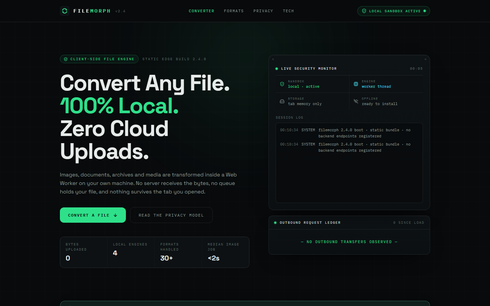

<div align="center">

# FileMorph

### Convert any file. 100% local. Zero cloud uploads.

[](./LICENSE)




</div>

---

## Overview

FileMorph converts images, documents, archives and media **entirely in your browser**. Files are processed in a Web Worker on your own machine. No server receives the bytes, nothing is queued in the cloud, and nothing remains after you close the tab.

## Features

- **Four local engines:** image, document, archive and media
- **30+ formats**, listed in a formats matrix
- **Drag-and-drop** file input
- **Runs in a Web Worker**, so the page stays responsive during conversion
- **Outbound request ledger:** a live log showing that no file data leaves the browser
- **Session log** and live security monitor
- **Works offline:** installable as a PWA with a service worker
- **Archive output** as ZIP or TAR

## Tech stack

| Area | Tools |
| --- | --- |
| UI | React 19, TypeScript, Tailwind CSS 4, Framer Motion, Lucide icons |
| Build | Vite 7 |
| Routing | React Router 7 |
| Conversion | pdf.js, jsPDF, JSZip, fflate, lamejs (MP3), custom GIF and TAR encoders |
| Offline | Web App Manifest and service worker |

## Getting started

```bash
git clone https://github.com/legend0x01/ConverterV2.git
cd ConverterV2
npm install
npm run dev       # start the dev server
npm run build     # production build in dist/
npm run preview   # preview the production build
```

## Project structure

```
src/
├── components/   # Hero, Converter, Dropzone, FormatsMatrix, NetworkLedger, ...
├── pages/        # Home, Formats, Privacy, Tech
├── lib/convert/  # Image, document, archive and media engines
├── workers/      # convert.worker.ts (runs conversions off the main thread)
└── main.tsx
public/           # Icons, manifest, service worker
```

## License

Released under the [MIT License](LICENSE).
